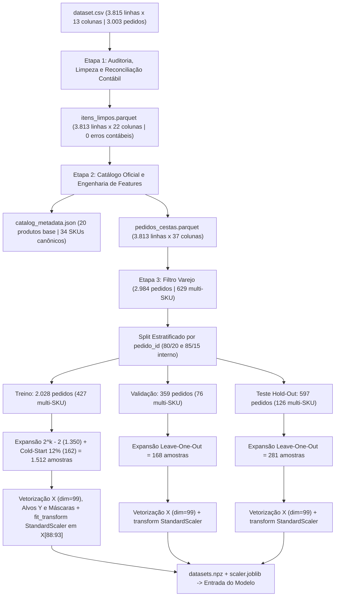

# Descrição Completa do Pré-Processamento dos Dados

Este documento descreve, em ordem cronológica de execução e com rigor matemático, todas as etapas de auditoria, limpeza, reconciliação contábil, engenharia de *features*, particionamento anti-*leakage*, expansão de cestas, vetorização e escalonamento realizadas sobre os dados brutos (`dataset.csv`) antes da entrada na rede neural principal (`FairMultiTaskRecommender`) e nos modelos comparativos.

---

## 1. Visão Geral do Pipeline de Dados

Todo o pré-processamento foi projetado com base em **funções puras determinísticas** (camada `src/utils/`) separadas da orquestração de DataFrames e persistência (camada `src/data/`), garantindo reprodutibilidade total (`SEED = 42`), invariantes contábeis verificadas por `assert` e **zero *training-serving skew*** (a inferência reutiliza exatamente a mesma lógica de vetorização e o mesmo `StandardScaler` ajustado no treino).

### Resumo de Volumetria por Estágio

| Estágio | Linhas / Amostras | Pedidos Únicos | Colunas / Dimensão | Observação Principal |
| :--- | :---: | :---: | :---: | :--- |
| **Dados Brutos (`dataset.csv`)** | `3.815` linhas | `3.003` | `13` colunas | `58` strings brutas de produtos; `16` eventos; `139` pedidos divergentes |
| **Etapa 1 (`itens_limpos.parquet`)** | `3.813` linhas | `3.003` | `22` colunas | `-3` colunas inválidas/redundantes; `-2` itens com `qtd <= 0`; `0` erros contábeis |
| **Etapa 2 (`pedidos_cestas.parquet`)** | `3.813` linhas | `3.003` | `37` colunas | Consolidação `(pedido_id, sku)` + `20` bases / `34` SKUs + features temporais |
| **Filtro de Escopo (`is_pedido_varejo`)** | `3.755` linhas | `2.984` | `37` colunas | Exclui `19` pedidos (`2` gratuitos e `18` consolidados, com `1` interseção) |
| **Tensores Treino (`train_X`)** | `1.512` amostras | `2.028` (`427` multi-SKU) | `X: (1512, 99)` | `1.350` subconjuntos ($2^k-2$) + `162` *cold-start* |
| **Tensores Validação (`val_X`)** | `168` amostras | `359` (`76` multi-SKU) | `X: (168, 99)` | Avaliação *Leave-One-Out* ($k$ amostras/pedido) |
| **Tensores Teste (`test_X`)** | `281` amostras | `597` (`126` multi-SKU) | `X: (281, 99)` | Avaliação *Leave-One-Out* ($k$ amostras/pedido), *hold-out* intocado |

---

## 2. Caracterização da Entrada Bruta (`dataset.csv`)

O arquivo bruto contém **`3.815` registros de itens** pertencentes a **`3.003` pedidos** realizados em feiras entre `09/03/2026` e `02/11/2026`, estruturados em **`13` colunas**:

| Coluna Original | Tipo Bruto | Nulos | Papel / Diagnóstico Inicial |
| :--- | :--- | :---: | :--- |
| `pedido_id` | `str` (UUID) | `0` | Chave primária de agrupamento por pedido (`3.003` únicos) |
| `pedido_data` | `str` (ISO/misto) | `0` | Timestamp bruto da venda (convertido para fuso `-03:00`) |
| `evento_nome` | `str` | `0` | Nome da feira (`16` valores brutos, alguns com espaços extras ou caixas separados) |
| `pedido_metodo_pagamento` | `str` | `0` | Meio de pagamento (`6` grafias distintas, incluindo `"Pix"` e `"PIX"`) |
| `pedido_subtotal` | `int64` | `0` | Soma bruta dos itens do pedido antes do desconto (R$) |
| `pedido_tipo_desconto` | `str` | `0` | Indicador `'R$'` (`1.049` linhas) ou `'%'` (`2.766` linhas) — auditado antes de descarte |
| `pedido_valor_desconto` | `float64` | `0` | Valor do desconto aplicado ao pedido (`192` pedidos com valor $> 0$) |
| `pedido_valor_total` | `float64` | `0` | Valor líquido final pago no pedido (R$) |
| `pedido_vendedor` | `str` (UUID) | `1` | Login compartilhado do caixa (apenas 2 UUIDs) — **removida** |
| `item_pedido_user_id` | `str` (UUID) | `1` | 100% idêntica a `pedido_vendedor` em todas as linhas — **removida** |
| `item_pedido_nome_produto` | `str` | `0` | Nome bruto do item (`58` strings distintas com variações de espaços e embalagens) |
| `item_pedido_quantidade` | `int64` | `0` | Quantidade registrada no PDV (mistura de unidades e pacotes entre feiras; `2` linhas com `0`) |
| `item_pedido_preco_unitario` | `float64` | `0` | Preço registrado no PDV (mistura de preço unitário e preço de pacote entre feiras) |

---

## 3. Etapa 1 — Auditoria, Limpeza e Reconciliação Contábil

Implementada em `src/utils/cleaning.py` (funções puras) e orquestrada em `src/data/preprocessing.py`.

### Passo 1.1 — Remoção de Colunas Inválidas de Operador/Vendedor

As colunas `pedido_vendedor` e `item_pedido_user_id` são removidas logo na entrada. A auditoria comprovou que:
- Ambas são **100% idênticas** em todas as `3.815` linhas;
- Contêm apenas **2 UUIDs** (`aa4d1cfe-...`: `2.102` linhas; `3f621f3e-...`: `1.712` linhas) além de `1` valor `NaN`, correspondendo a contas de login compartilhado no aplicativo de PDV (e não a identidade individual de vendedores).

### Passo 1.2 — Validação Matemática e Padronização de Descontos

Antes de descartar `pedido_tipo_desconto`, cada linha passa pela função pura `validar_desconto_em_moeda` com tolerância monetária $\varepsilon_{\text{mon}} = 0{,}01$:

1. **Verificação direta em moeda (R$):**
   $$\big|(\text{subtotal} - d) - \text{total}\big| < \varepsilon_{\text{mon}} \implies d_{\text{R\$}} = d \quad (\text{status: } \texttt{ja\_em\_moeda})$$
2. **Verificação alternativa em percentual (%):** caso a condição anterior falhe, testa-se se $d$ foi armazenado como taxa percentual:
   $$d_{\text{pct}} = \text{subtotal} \cdot \frac{d}{100}, \qquad \big|(\text{subtotal} - d_{\text{pct}}) - \text{total}\big| < \varepsilon_{\text{mon}} \implies d_{\text{R\$}} = \operatorname{round}(d_{\text{pct}}, 4)$$
3. **Bloqueio de inconsistência:** se ambas falharem, o pipeline interrompe a execução via `AssertionError`.

**Achado empírico e resultado:**
- Entre os `192` pedidos com desconto positivo, `191` estavam rotulados como `'R$'` e apenas **1 pedido** (`ca605a42-...`, `EXPOBENTO`, $\text{subtotal} = 6{,}00$, $d = 0{,}12$, $\text{total} = 5{,}88$) estava rotulado como `'%'` — porém $6{,}00 - 0{,}12 = 5{,}88$, provando que **100% dos descontos (`3.815 / 3.815` linhas) já estavam gravados em reais** (`0` conversões necessárias, `0` inconsistências).
- Somente após essa comprovação programática, a coluna `pedido_tipo_desconto` é removida.

### Passo 1.3 — Remoção de Itens com Quantidade Não Positiva

Aplica-se o predicado booleano:
$$\text{item\_valido}(q_{\text{bruta}}) = \mathbb{I}(q_{\text{bruta}} > 0)$$

- **Removidas exatamente `2` linhas** com $q_{\text{bruta}} = 0$ (itens cancelados/substituídos dentro de pedidos válidos):
  1. Pedido `ebbed809-e6f4-4b4a-9850-60eaa218e98b` (`Expo Afubra`) — `Alfajor Preto (Caixa x16)`, $q = 0$;
  2. Pedido `4680d5c5-3262-4e60-829e-5a9f976edaff` (`EXPOBENTO`) — `Rapadura de Melado`, $q = 0$.
- **Resultado:** `3.815 → 3.813` linhas válidas, mantendo todos os `3.003` pedidos intactos.

### Passo 1.4 — Detecção Prévia de Pedidos Contabilmente Divergentes

Antes da reconciliação de embalagens, calcula-se a soma monetária bruta de cada pedido $p$:
$$S^{\text{bruta}}_p = \sum_{i \in p} q^{\text{bruta}}_i \cdot P^{\text{bruto}}_i$$

Define-se a *flag* de divergência prévia do pedido:
$$\text{divergente}_p = \mathbb{I}\!\left(\big|S^{\text{bruta}}_p - \text{subtotal}_p\big| \ge 0{,}01\right)$$

- **Achado empírico:** foram detectados **139 pedidos divergentes** no dado bruto (`100%` ocorridos na feira `ExpoDireto`), nos quais o PDV gravou a quantidade em **unidades individuais**, mas gravou o **preço do pacote inteiro** em `item_pedido_preco_unitario`.

### Passo 1.5 — Saneamento Lexical e Normalização Categórica

1. **Limpeza lexical de texto (`normalizar_texto_produto`):**
   $$s_{\text{limpo}} = \operatorname{strip}\!\Big(\operatorname{re\_sub}(\texttt{\textbackslash s+},\; \texttt{" "},\; s_{\text{bruto}})\Big)$$
   Remove espaços nas extremidades e colapsa múltiplos espaços internos (ex.: `"Bolacha de manteiga  (Un)"`, `"Pão branco "`, `"Expo Dona Francisca "`).

2. **Extração de `produto_base` com proteção contra fusão indevida (`extrair_produto_base`):**
   - Remove-se qualquer texto entre parênteses via expressão regular `\s*\([^)]*\)\s*` $\rightarrow$ `" "`, seguido de colapso de espaços e `.strip()`.
   - Aplica-se exclusivamente um dicionário explícito de sinônimos confirmados pelo negócio (**nenhuma fusão automática por similaridade textual é permitida**):
     $$\text{"Amendoim salgado e temperado"} \; (38\text{ linhas, R\$ 8,00}) \longmapsto \text{"Amendoim Temperado"}$$
   - Produtos distintos em gramatura, receita ou sabor permanecem 100% separados (ex.: `"Amendoim Temperado"` R$ 8,00 $\neq$ `"Amendoim Temperado 100g"` R$ 6,00; `"Rapadura de Melado"` $\neq$ `"Rapadura de Melado Grão Moído"`).
   - **Resultado:** exatamente **20 produtos base** canônicos.

3. **Normalização de Eventos (uso restrito à auditoria e EDA — não entra na rede neural):**
   - Preserva-se `evento_original` e cria-se o par `(evento_nome, ponto_venda)`:
     - `"1 Moranguinho"` $\mapsto$ `("Festa do Moranguinho", "Caixa 1")` (`214` linhas);
     - `"2-Moranguinho"` $\mapsto$ `("Festa do Moranguinho", "Caixa 2")` (`248` linhas);
     - Demais `14` feiras $\mapsto$ `(evento_limpo, "Padrão")` (`3.351` linhas).
   - `16` eventos brutos $\rightarrow$ `15` eventos unificados.

4. **Padronização de Método de Pagamento:**
   - Capitalização (`pedido_metodo_pagamento`): `"Pix"` (`383` linhas) + `"PIX"` (`24` linhas) $\mapsto$ `"PIX"` (`407` linhas); demais preservados (`Dinheiro`: `2.197`, `Cartão`: `1.127`, `Cartão de Débito`: `58`, `Cartão de Crédito`: `24`).
   - Agrupamento (`metodo_pagamento_grupo`): unifica `"Cartão"`, `"Cartão de Crédito"` e `"Cartão de Débito"` em `"Cartão"` (`1.209`), mantendo `"Dinheiro"` (`2.197`) e `"PIX"` (`407`).

### Passo 1.6 — Extração Determinística de Embalagem e Multiplicador ($m$)

A função `extrair_embalagem_e_multiplicador` determina o par $(\text{tipo\_embalagem}, m)$ por ordem estrita de prioridade:

1. **Padrão com multiplicador explícito** — regex `\((Pacote|Fardo|Bandeja|Caixa|Display)\s+x(\d+)\)\s*$` (*case-insensitive*):
   - Extrai $\text{tipo\_embalagem} = \operatorname{capitalize}(\text{grupo}_1)$ e $m = \operatorname{int}(\text{grupo}_2)$.
   - **Exceção verificada por preço:** para `Rapadura de Melado Grão Moído (Pacote x1)` com $P^{\text{bruto}} \ge 18{,}00$ (`16` ocorrências a R$ 20,00), o pacote contém 3 unidades ($3 \times \text{R\$ } 6{,}67 = \text{R\$ } 20{,}00$), sendo corrigido deterministicamente para `("Pacote", 3)`.
   - Já `Alfajor Preto/Branco (Display x1)` a R$ 5,00 (`25` ocorrências) mantém `("Display", 1)`.

2. **Padrão sem multiplicador explícito (`1 Moranguinho`, `59` linhas)** — regex `\((Pacote|Fardo)\)\s*$` (*case-insensitive*):
   - Resolvido via tabela determinística validada pelo preço unitário da feira (qualquer par fora do mapa lança `ValueError`):

   | `produto_base` | `tipo_embalagem` | Preço Registrado | Multiplicador ($m$) | Preço Unitário Resultante |
   | :--- | :---: | :---: | :---: | :---: |
   | `Cuca Alemã` | `Fardo` | R$ 60,00 | `3` | R$ 20,00 |
   | `Rapadura Assada` | `Pacote` | R$ 25,00 | `6` | R$ 4,17 |
   | `Rapadura de Melado` | `Pacote` | R$ 20,00 | `3` | R$ 6,67 |
   | `Alfajor Preto` | `Pacote` | R$ 20,00 | `4` | R$ 5,00 |
   | `Cuca Enrolada de Amendoim` | `Pacote` | R$ 25,00 | `2` | R$ 12,50 |
   | `Cuca Enrolada de Chocolate` | `Pacote` | R$ 30,00 | `2` | R$ 15,00 |

3. **Padrão unitário (`(Un)` ou ausência de parênteses):** retorna `("Unidade", 1)`.

### Passo 1.7 — Reconciliação Contábil de Quantidades e Preços (Casos A, B, C e D)

Para diferenciar registros feitos em **número de pacotes** (com preço do pacote) de registros feitos em **unidades base**, define-se a *flag* auxiliar `registro_em_pacotes`:

$$\text{reg\_pacotes}_i = (m_i > 1) \land (\neg \text{divergente}_p) \land \Big(\text{evento\_original}_i = \text{"ExpoDireto"} \;\lor\; \text{"(Pacote)"} \in s_i \;\lor\; \text{"(Fardo)"} \in s_i \;\lor\; \text{"(Pacote x1)"} \in s_i\Big)$$

Com $q = q^{\text{bruta}}_i$, $P = P^{\text{bruto}}_i$ e $m = m_i$, a função pura `reconciliar_quantidade_e_preco` resolve cada item em exatamente **4 casos mutuamente exclusivos**:

| Caso | Condição Lógica | $q_{\text{un}}$ (`qtd_unidades_base`) | $q_{\text{pct}}$ (`qtd_pacotes`) | $P_{\text{un}}$ (`preco_unitario`) | $P_{\text{pct}}$ (`preco_pacote`) | Ocorrências |
| :---: | :--- | :---: | :---: | :---: | :---: | :---: |
| **A** | $m = 1$ (venda unitária) | $q$ | $q$ | $P$ | $P$ | `2.947` |
| **B** | $m > 1 \land \text{divergente}_p$ (`ExpoDireto`) | $q$ | $q / m$ | $P / m$ | $P$ | `148` |
| **C** | $m > 1 \land \neg\text{divergente}_p \land \text{reg\_pacotes}_i$ | $q \cdot m$ | $q$ | $P / m$ | $P$ | `86`\* |
| **D** | Demais casos com $m > 1$ (padrão das demais feiras) | $q$ | $q / m$ | $P$ | $P \cdot m$ | `632` |

\*Decomposição exata do Caso C (`86` linhas): `11` linhas não divergentes de pacote na `ExpoDireto` + `59` linhas `(Pacote)`/`(Fardo)` na `1 Moranguinho` + `16` linhas da exceção `(Pacote x1)` a R$ 20,00.

**Validações matemáticas e derivação de chaves:**
- **Integralidade de pacotes (Casos B e D):** exige-se com tolerância $\varepsilon_{\text{int}} = 10^{-6}$:
  $$\left|\frac{q}{m} - \operatorname{round}\!\left(\frac{q}{m}\right)\right| \le 10^{-6}$$
  Resultado: **0 linhas fracionárias** em todas as `3.813` linhas.
- **Valor total reconciliado do item:**
  $$v_i = \operatorname{round}\!\left(q_{\text{un}, i} \cdot P_{\text{un}, i},\; 6\right)$$
- **Chave canônica do SKU (`produto_com_multiplicador`):**
  $$\text{sku\_norm}_i = \texttt{"\{produto\_base\} (x\{m\})"}$$
  Exemplo: `"Rapadura Assada (x6)"`. Essa padronização reduz a fragmentação de **`58` nomes brutos** para exatamente **`34` SKUs canônicos**.
- **Invariante contábil global pós-reconciliação:**
  $$\forall p \in \{1, \dots, 3003\}:\quad \left|\sum_{i \in p} v_i - \text{subtotal}_p\right| < 0{,}01$$
  **Resultado empírico:** redução de **`139 → 0` pedidos divergentes**, com erro absoluto máximo observado de **R$ 0,000000**.

### Passo 1.8 — Segmentação de Pedidos (Gratuitos, Consolidados e Varejo)

Com as quantidades reconciliadas agregadas por pedido $p$, classificam-se 3 *flags* booleanas para isolar o comportamento de balcão (varejo) de lançamentos atípicos (fechamentos de caixa/atacado e cortesias):

1. **Pedido gratuito (desconto de 100%):**
   $$\text{is\_pedido\_gratuito}_p = \mathbb{I}\!\left(\text{valor\_total}_p \le 0{,}0\right)$$
   Identifica **`2` pedidos**: um de R$ 6,00 na `ExpoDireto` e um fechamento de R$ 915,00 em `São Francisco de Assis`.

2. **Pedido consolidado / fechamento de caixa (*outlier*):**
   $$\text{is\_pedido\_consolidado}_p = \mathbb{I}\!\left(\text{subtotal}_p \ge 200{,}0 \;\lor\; \sum_{i \in p} q_{\text{un}, i} \ge 40 \;\lor\; \text{evento\_original}_p \in \{\text{"Feira Polêsine"},\; \text{"ExpoSerra"}\}\right)$$
   Identifica **`18` pedidos** (`16` por subtotal $\ge$ R$ 200, `12` por volume $\ge 40$ unidades, `8` pertencentes a `Feira Polêsine`/`ExpoSerra`, sendo `2` exclusivos pelo critério de evento).

3. **Pedido de varejo (escopo de modelagem):**
   $$\text{is\_pedido\_varejo}_p = \big(\neg \text{is\_pedido\_consolidado}_p\big) \land \big(\neg \text{is\_pedido\_gratuito}_p\big)$$
   Como `1` pedido (`São Francisco de Assis`, R$ 915,00) é simultaneamente gratuito e consolidado, excluem-se exatamente $|G \cup C| = 2 + 18 - 1 = 19$ pedidos (`58` linhas), restando **`2.984` pedidos de varejo** (`3.755` linhas). Todos os `3.003` pedidos permanecem em `itens_limpos.parquet` para rastreabilidade e auditoria.

### Passo 1.9 — Padronização Temporal (*Timezone*) e Tipagem Forte

- A coluna `pedido_data` é convertida via `pd.to_datetime(..., format="mixed", utc=True).dt.tz_convert("America/Sao_Paulo")` (`UTC-03:00`).
- As **`22` colunas finais** são tipadas estritamente em `string`, `datetime64[us, America/Sao_Paulo]`, `category` (8 colunas), `int64` (3 colunas), `float64` (6 colunas) e `bool` (3 colunas), e salvas em `data/processed/itens_limpos.parquet`.

---

## 4. Etapa 2 — Catálogo Oficial e Engenharia de Features

Implementada em `src/utils/temporal.py` e `src/data/features.py`, recebe `itens_limpos.parquet` e produz `catalog_metadata.json` e `pedidos_cestas.parquet`.

### Passo 2.1 — Construção Determinística do Catálogo Oficial (`catalog_metadata.json`)

1. **Indexação fixa por ordenação alfabética:**
   - Produtos base ordenados alfabeticamente $\Rightarrow$ `base_id` $\in \{0, 1, \dots, 19\}$ ($N_{\text{bases}} = 20$).
   - SKUs canônicos ordenados alfabeticamente $\Rightarrow$ `sku_id` $\in \{0, 1, \dots, 33\}$ ($N_{\text{skus}} = 34$).

2. **Preço unitário avulso de referência por produto base $b$:**
   $$P^{\text{avulso\_ref}}_b = \begin{cases} \operatorname{round}\!\Big(\operatorname{mediana}\big(\{P_{\text{un}, i} : \text{base}_i = b \land m_i = 1\}\big),\; 2\Big), & \text{se houver vendas com } m = 1 \\ \operatorname{round}\!\Big(\operatorname{mediana}\big(\{P_{\text{un}, i} : \text{base}_i = b\}\big),\; 2\Big), & \text{caso contrário} \end{cases}$$

3. **Preços de referência, embalagem canônica e nome de exibição por SKU $s$:**
   $$P^{\text{pct\_ref}}_s = \operatorname{round}\!\Big(\operatorname{mediana}\big(\{P_{\text{pct}, i} : \text{sku}_i = s\}\big),\; 2\Big), \qquad P^{\text{un\_ref}}_s = \operatorname{round}\!\left(\frac{P^{\text{pct\_ref}}_s}{m_s},\; 2\right)$$
   - `tipo_embalagem`: moda histórica da embalagem para o SKU $s$.
   - `display_name`: `"{produto_base} (Unidade)"` se $m_s \le 1$, ou `"{produto_base} ({tipo_embalagem} x{m_s})"` se $m_s > 1$.

4. **Economia unitária percentual da embalagem:**
   $$\text{economia\_unitaria\_pct}(P_{\text{un}}, P^{\text{avulso\_ref}}_b) = \begin{cases} 0{,}0, & \text{se } P^{\text{avulso\_ref}}_b \le 0 \\ \operatorname{round}\!\left(\max\!\left(0{,}0,\; \left(1 - \frac{P_{\text{un}}}{P^{\text{avulso\_ref}}_b}\right) \times 100\right),\; 2\right), & \text{caso contrário} \end{cases}$$
   *(Ex.: `Alfajor Preto (Bandeja x5)` custa R$ 4,00/un frente a R$ 6,00/un avulso $\Rightarrow 33{,}33\%$ de economia unitária.)*

### Passo 2.2 — Consolidação de Cestas por `(pedido_id, produto_com_multiplicador)`

Realiza-se agrupamento preventivo `groupby(["pedido_id", "produto_com_multiplicador"])` somando `qtd_unidades_base`, `qtd_pacotes` e `item_valor_total` caso o mesmo SKU apareça em linhas duplicadas após a normalização, recalculando os preços efetivos ponderados:

$$P_{\text{un}} = \frac{\sum \text{item\_valor\_total}}{\sum \text{qtd\_unidades\_base}}, \qquad P_{\text{pct}} = P_{\text{un}} \cdot m$$

- **Preservação de múltiplas embalagens do mesmo produto base:** pedidos em que o cliente levou o mesmo `produto_base` em embalagens distintas (`27` pedidos no varejo, ex.: unidade + pacote) permanecem como linhas/SKUs separados na cesta.
- **Volume consolidado:** `3.813` linhas (`0` duplicatas de SKU no mesmo pedido), com `37` colunas.
- **Invariantes obrigatórias (`assert`):**
  1. $q_{\text{pct}} \cdot m = q_{\text{un}}$ em 100% das linhas;
  2. $\max |P_{\text{un}} \cdot m - P_{\text{pct}}| < 0{,}02$;
  3. **0 valores nulos** em toda a tabela `pedidos_cestas.parquet`.

### Passo 2.3 — Engenharia de Features Temporais Genéricas

Extraídas de `pedido_data` (no fuso `America/Sao_Paulo`), **sem dependência de `evento_nome`** para que o modelo opere em qualquer feira nova sem re-treinamento:

1. **Codificação cíclica da hora** ($h \in \{0, 1, \dots, 23\}$):
   $$\theta(h) = \frac{2\pi (h \bmod 24)}{24}, \qquad \text{hora\_sin}(h) = \operatorname{round}\!\big(\sin \theta(h),\; 6\big), \qquad \text{hora\_cos}(h) = \operatorname{round}\!\big(\cos \theta(h),\; 6\big)$$
   A projeção no círculo unitário evita a descontinuidade artificial entre `23h` e `00h` presente na representação escalar linear.

2. **Discretização em faixa horária** (ordem fixa `("Manhã", "Tarde", "Noite")`, convertida posteriormente em *One-Hot* de 3 dimensões):
   $$\text{faixa\_horaria}(h) = \begin{cases} \text{Manhã}, & h < 12 \\ \text{Tarde}, & 12 \le h < 18 \\ \text{Noite}, & h \ge 18 \end{cases}$$

3. **Indicador de fim de semana** ($d \in \{0=\text{Seg}, \dots, 5=\text{Sáb}, 6=\text{Dom}\}$ na convenção Pandas):
   $$\text{fim\_de\_semana}(d) = \mathbb{I}(d \ge 5)$$

4. **Atributos auxiliares de cesta (para EDA e estratificação):**
   - `n_skus_pedido` ($k_p$: quantidade de SKUs distintos no pedido $p$);
   - `n_bases_pedido` (quantidade de produtos base distintos no pedido $p$);
   - `is_multi_sku` $= \mathbb{I}(k_p \ge 2)$;
   - `teve_desconto` $= \mathbb{I}(\text{pedido\_valor\_desconto} > 0)$;
   - `mes`, `hora`, `dia_semana`.

---

## 5. Etapa 3 — Filtro de Escopo, Split Anti-Leakage e Expansão de Cestas

Implementada em `src/utils/baskets.py` e `src/data/dataset_builder.py`.

### Passo 3.1 — Filtro de Escopo (Varejo) e Distribuição das Cestas

Mantêm-se exclusivamente os pedidos com `is_pedido_varejo == True`: **`2.984` pedidos** (`3.755` itens), com a seguinte distribuição do tamanho da cesta $k_p$ (SKUs distintos por pedido):

| Tamanho da Cesta ($k_p$) | Pedidos de Varejo | Participação | Papel na Modelagem |
| :---: | :---: | :---: | :--- |
| $k = 1$ | `2.355` | `78,9%` | Elegíveis para *Cold-Start* no treino e baselines de popularidade |
| $k = 2$ | `514` | `17,2%` | Cross-sell ($2^2-2 = 2$ subconjuntos no treino; $2$ amostras LOO em val/teste) |
| $k = 3$ | `94` | `3,15%` | Cross-sell ($2^3-2 = 6$ subconjuntos no treino; $3$ amostras LOO em val/teste) |
| $k = 4$ | `16` | `0,54%` | Cross-sell ($2^4-2 = 14$ subconjuntos no treino; $4$ amostras LOO em val/teste) |
| $k = 5$ | `4` | `0,13%` | Cross-sell ($2^5-2 = 30$ subconjuntos no treino) |
| $k = 6$ | `1` | `0,03%` | Cross-sell ($6$ amostras LOO no teste) |
| **Total Multi-SKU ($k \ge 2$)** | **`629`** | **`21,1%`** | **Base supervisionada de co-compra** |

> **Por que os `2.355` pedidos de 1 item não recebem classe `"NÃO_RECOMENDAR"`?**
> Como não havia recomendador no histórico das feiras, a ausência de um segundo item não equivale a rejeição explícita. Criar uma classe negativa majoritária (`78,9%`) enviesaria a rede a prever "nada" trivialmente, degradando o ranking de *cross-sell*. Em vez disso, esses pedidos são usados de forma saudável na amostragem *Cold-Start* do treino (carrinho vazio $\rightarrow$ item comprado no contexto horário).

### Passo 3.2 — Particionamento Estratificado Anti-Leakage por `pedido_id`

A regra estrutural é **dividir primeiro por `pedido_id`, expandir cestas depois**, impedindo que diferentes subconjuntos de um mesmo pedido apareçam simultaneamente no treino e na validação/teste (*data leakage*).

Define-se a variável de estratificação por pedido $p$:
$$\text{estrato}(p) = \begin{cases} 0, & \text{se } k_p = 1 \\ 1, & \text{se } k_p = 2 \\ 2, & \text{se } k_p \ge 3 \end{cases}$$

Aplicam-se dois splits estratificados sequenciais com `SEED = 42` (`sklearn.model_selection.train_test_split`):
1. **Split Externo (80% / 20%):**
   - **Desenvolvimento (`dev_ids`, 80%):** `2.387` pedidos;
   - **Teste Hold-Out (`test_ids`, 20%):** `597` pedidos (mantido intocado durante todo o ajuste de hiperparâmetros e treinamento).
2. **Split Interno (85% / 15% dentro de Desenvolvimento $\approx$ 68% / 12% do total):**
   - **Treino (`train_ids`):** `2.028` pedidos (`68,0%`);
   - **Validação (`val_ids`):** `359` pedidos (`12,0%`, usada para *Early Stopping*, *ReduceLROnPlateau* e Optuna).

**Contagem exata por partição e verificação de disjunção:**

| Partição | Total Pedidos | $k=1$ | $k=2$ | $k=3$ | $k=4$ | $k=5$ | $k=6$ | Total Multi-SKU ($k \ge 2$) |
| :--- | :---: | :---: | :---: | :---: | :---: | :---: | :---: | :---: |
| **Treino (`train_ids`)** | `2.028` | `1.601` | `349` | `63` | `11` | `4` | `0` | `427` |
| **Validação (`val_ids`)** | `359` | `283` | `62` | `12` | `2` | `0` | `0` | `76` |
| *Desenvolvimento (`dev_ids`)* | *`2.387`* | *`1.884`* | *`411`* | *`75`* | *`13`* | *`4`* | *`0`* | *`503`* |
| **Teste Hold-Out (`test_ids`)** | `597` | `471` | `103` | `19` | `3` | `0` | `1` | `126` |
| **Total Varejo** | **`2.984`** | **`2.355`** | **`514`** | **`94`** | **`16`** | **`4`** | **`1`** | **`629`** |

Asserções formais executadas: $\text{Dev} \cap \text{Test} = \emptyset$, $\text{Train} \cap \text{Val} = \emptyset$, $\text{Train} \cap \text{Test} = \emptyset$ e $\text{Val} \cap \text{Test} = \emptyset$.

### Passo 3.3 — Expansão Combinatória de Cestas em Exemplos Supervisionados

#### A. Conjunto de Treino — Subconjuntos Próprios Não Vazios ($2^k - 2$) + Cold-Start

Como o carrinho de compras é um conjunto não ordenado ($\{A, B\} \equiv \{B, A\}$), cada pedido multi-SKU de treino $B_p$ com $k = |B_p| \ge 2$ é expandido em todos os seus **subconjuntos próprios não vazios** (em vez de permutações $k!$, evitando amostras duplicadas):

$$\mathcal{P}_{\text{sub}}(B_p) = \Big\{(S,\; T) \;\Big|\; \emptyset \subsetneq S \subsetneq B_p,\; T = B_p \setminus S\Big\}, \qquad |\mathcal{P}_{\text{sub}}(B_p)| = \sum_{r=1}^{k-1} \binom{k}{r} = 2^k - 2$$

- Exemplo para $B_p = \{A, B, C\}$ ($k=3 \Rightarrow 6$ pares únicos):
  $(\{A\}, \{B,C\})$, $(\{B\}, \{A,C\})$, $(\{C\}, \{A,B\})$, $(\{A,B\}, \{C\})$, $(\{A,C\}, \{B\})$, $(\{B,C\}, \{A\})$.
- **Volume exato gerado no treino (*cross-sell*):**
  $$N_{\text{cross}} = 349(2^2 - 2) + 63(2^3 - 2) + 11(2^4 - 2) + 4(2^5 - 2) = 698 + 378 + 154 + 120 = \mathbf{1.350\text{ amostras}}$$

- **Aumentação de *Cold-Start* (exclusiva no treino):**
  Para que o modelo aprenda recomendações contextuais por horário quando o carrinho está vazio ($S = \emptyset$), seleciona-se aleatoriamente sem reposição (`np.random.default_rng(42)`) uma fração $\rho_{\text{cold}} = 0{,}12$ sobre os `2.028` pedidos de treino com $k \ge 1$:
  $$n_{\text{cold}} = \max\!\Big(1,\; \operatorname{round}(N_{\text{cross}} \times 0{,}12)\Big) = \operatorname{round}(1350 \times 0{,}12) = \mathbf{162\text{ amostras}}$$
  Cada amostra *cold-start* tem entrada vazia $S = \emptyset$ e alvo $T = B_p$ (todos os itens do pedido).
- **Total de amostras no Treino:** $N_{\text{train}} = 1.350 + 162 = \mathbf{1.512\text{ amostras}}$.

#### B. Conjuntos de Validação e Teste — *Leave-One-Out* (LOO)

Para avaliação determinística e comparável entre modelos, cada pedido multi-SKU ($k \ge 2$) gera exatamente $k$ casos ocultando 1 item por vez (sem *cold-start*):

$$\mathcal{P}_{\text{LOO}}(B_p) = \Big\{\big(B_p \setminus \{i\},\; \{i\}\big) \;\Big|\; i \in B_p\Big\}, \qquad |\mathcal{P}_{\text{LOO}}(B_p)| = k$$

- **Volume exato na Validação:** $N_{\text{val}} = 62(2) + 12(3) + 2(4) = \mathbf{168\text{ amostras}}$.
- **Volume exato no Teste Hold-Out:** $N_{\text{test}} = 103(2) + 19(3) + 3(4) + 1(6) = \mathbf{281\text{ amostras}}$.

#### C. Invariante Anti-Vazamento Intra-Amostra

Em 100% das amostras de treino, validação e teste verifica-se via `assert` que entrada e alvo são estritamente disjuntos:
$$\forall s \in \{0, \dots, 33\}:\quad x^{\text{sku\_bin}}_s \cdot y^{\text{sku}}_s = 0$$

---

## 6. Etapa 4 — Vetorização ($X \in \mathbb{R}^{99}$), Alvos ($Y$), Máscaras e Escalonamento

Implementada na função pura `construir_vetor_entrada_raw` (`src/utils/baskets.py`) e padronizada em `src/data/dataset_builder.py`.

### Passo 4.1 — Construção do Vetor de Entrada Bruto $\mathbf{x}_{\text{raw}} \in \mathbb{R}^{99}$ (`float32`)

Dado um carrinho parcial $S$ (agregando `qtd_pacotes` por `sku_id`, garantindo $q_s = \max(1, \text{qtd\_pacotes}_s)$), hora $h \in \{0,\dots,23\}$ e dia da semana $d \in \{0,\dots,6\}$, o vetor $\mathbf{x}_{\text{raw}}$ é a concatenação ordenada de **5 blocos**:

$$\mathbf{x}_{\text{raw}} = \Big[\;\mathbf{x}_{\text{sku\_bin}} \;\Big\|\; \mathbf{x}_{\text{sku\_qty}} \;\Big\|\; \mathbf{x}_{\text{base\_bin}} \;\Big\|\; \mathbf{x}_{\text{cart\_stats}} \;\Big\|\; \mathbf{x}_{\text{time}}\;\Big] \in \mathbb{R}^{99}$$

| Bloco | Índices | Dimensão | Fórmula Matemática | Escalonamento |
| :--- | :---: | :---: | :--- | :--- |
| **`x_cart_sku_bin`** | `[0 : 34]` | `34` | $x_s = \mathbb{I}(s \in S) \in \{0, 1\}$ | Nenhum (binário) |
| **`x_cart_sku_qty`** | `[34 : 68]` | `34` | $x_{34+s} = \begin{cases} \ln(1 + q_s), & s \in S \\ 0, & s \notin S \end{cases}$ | `log1p` (preserva $0$) |
| **`x_cart_base_bin`** | `[68 : 88]` | `20` | $x_{68+b} = \mathbb{I}\!\big(\exists s \in S : \text{base}(s) = b\big) \in \{0, 1\}$ | Nenhum (binário) |
| **`x_cart_stats`** | `[88 : 93]` | `5` | Ver equações detalhadas abaixo | **`StandardScaler`** |
| **`x_time`** | `[93 : 99]` | `6` | Ver equações detalhadas abaixo | Nenhum ($[-1,1]$ / $\{0,1\}$) |

#### Detalhamento de `x_cart_stats` (Índices `88` a `92` — Perfil Dinâmico do Carrinho Parcial)

Computado **estritamente sobre os itens já presentes em $S$** (sem qualquer informação dos itens mascarados em $T$), utilizando o preço de referência do catálogo ($P^{\text{pct\_ref}}_s$) para manter paridade absoluta com a inferência em produção:

- **Índice `88` (`qtd_skus_carrinho`):**
  $$f_0 = |S|$$
- **Índice `89` (`log1p_total_pacotes`):**
  $$f_1 = \ln\!\left(1 + \sum_{s \in S} q_s\right)$$
- **Índice `90` (`log1p_total_unidades`):**
  $$f_2 = \ln\!\left(1 + \sum_{s \in S} q_s \cdot m_s\right)$$
- **Índice `91` (`log1p_valor_parcial`):**
  $$f_3 = \ln\!\left(1 + \sum_{s \in S} q_s \cdot P^{\text{pct\_ref}}_s\right)$$
- **Índice `92` (`tem_pacote_no_carrinho`):**
  $$f_4 = \mathbb{I}\!\big(\exists s \in S : m_s > 1\big) \in \{0, 1\}$$

> A transformação $\ln(1 + u)$ (`math.log1p`) comprime a cauda longa das quantidades e valores monetários, atenua *outliers* suaves e preserva o mapeamento exato $0 \mapsto 0$ (crítico para amostras de *Cold-Start*, onde $S = \emptyset \implies f_0 = f_1 = f_2 = f_3 = f_4 = 0$).

#### Detalhamento de `x_time` (Índices `93` a `98` — Contexto Temporal Genérico)

- **Índice `93`:** $\sin\!\left(\frac{2\pi (h \bmod 24)}{24}\right)$
- **Índice `94`:** $\cos\!\left(\frac{2\pi (h \bmod 24)}{24}\right)$
- **Índice `95` (*One-Hot* Manhã):** $\mathbb{I}(h < 12)$
- **Índice `96` (*One-Hot* Tarde):** $\mathbb{I}(12 \le h < 18)$
- **Índice `97` (*One-Hot* Noite):** $\mathbb{I}(h \ge 18)$
- **Índice `98` (Fim de Semana):** $\mathbb{I}(d \ge 5)$

### Passo 4.2 — Padronização Z-Score (`StandardScaler`) sem *Data Leakage*

A padronização Z-Score é aplicada **exclusivamente** no bloco contínuo `CART_STATS_SLICE = [88:93]`, mantendo intactos os vetores esparsos/binários e as coordenadas trigonométricas.

O `StandardScaler` do `scikit-learn` (`ddof=0`) tem seus parâmetros estimados **unicamente sobre as $N_{\text{train}} = 1.512$ amostras de treino** (`fit_transform`), aplicando apenas `.transform()` em Validação, Teste e Inferência:

$$\mu_j = \frac{1}{N_{\text{train}}} \sum_{i=1}^{N_{\text{train}}} x_{i,j}, \qquad \sigma_j = \sqrt{\frac{1}{N_{\text{train}}} \sum_{i=1}^{N_{\text{train}}} (x_{i,j} - \mu_j)^2}, \qquad \tilde{x}_{i,j} = \frac{x_{i,j} - \mu_j}{\sigma_j}$$

#### Parâmetros Exatos Aprendidos no Treino (`scaler.joblib`, $N = 1.512$)

| Índice em $X$ | Feature de `x_cart_stats` | Média ($\mu_j$) | Desvio Padrão ($\sigma_j$) | Variância ($\sigma_j^2$) |
| :---: | :--- | :---: | :---: | :---: |
| `88` | `qtd_skus_carrinho` ($|S|$) | `1,238757` | `0,765842` | `0,586514` |
| `89` | `log1p(total_pacotes)` | `0,837202` | `0,429779` | `0,184710` |
| `90` | `log1p(total_unidades)` | `1,071076` | `0,656668` | `0,431213` |
| `91` | `log1p(valor_parcial)` | `2,592183` | `1,105745` | `1,222671` |
| `92` | `tem_pacote_no_carrinho` | `0,255291` | `0,436025` | `0,190118` |

### Passo 4.3 — Construção dos Alvos Multi-Task ($Y$) e Máscaras de Entrada

Para cada amostra $(S, T)$, geram-se 3 tensores alvo (`construir_alvos_multitask`) e 2 máscaras binárias de exclusão:

1. **Alvo de Produto Base ($\mathbf{y}_{\text{base}} \in \{0, 1\}^{20}$):**
   $$y_{\text{base}, b} = \mathbb{I}\!\big(\exists s \in T : \text{base}(s) = b\big)$$
2. **Alvo de SKU Canônico ($\mathbf{y}_{\text{sku}} \in \{0, 1\}^{34}$):**
   $$y_{\text{sku}, s} = \mathbb{I}(s \in T)$$
3. **Alvo de Quantidade de Pacotes ($\mathbf{y}_{\text{qty}} \in \mathbb{R}_{\ge 0}^{34}$):**
   $$y_{\text{qty}, s} = \begin{cases} \ln(1 + q_s), & \text{se } s \in T \\ 0, & \text{se } s \notin T \end{cases}$$
   *(Na função de perda, o erro *Smooth L1 / Huber* é mascarado para incidir exclusivamente onde $y_{\text{sku}, s} = 1$. Na inferência, a predição contínua $\hat{y}_{\text{qty}, s}$ é invertida por $\hat{q}_{\text{pct}, s} = \max\big(1, \operatorname{round}(e^{\hat{y}_{\text{qty}, s}} - 1)\big)$.)*
4. **Máscaras de Itens Já no Carrinho ($\mathbf{m}_{\text{sku}} \in \{0, 1\}^{34}$ e $\mathbf{m}_{\text{base}} \in \{0, 1\}^{20}$):**
   $$\mathbf{m}_{\text{sku}} = \mathbf{x}_{\text{sku\_bin}}, \qquad \mathbf{m}_{\text{base}} = \mathbf{x}_{\text{base\_bin}}$$
   - **Na perda de SKU:** $\text{valid\_sku} = 1 - \mathbf{m}_{\text{sku}}$ (impede penalização de SKUs que já estão no carrinho);
   - **Na perda de Produto Base:** $\text{valid\_base} = \min\!\big(1,\; (1 - \mathbf{m}_{\text{base}}) + \mathbf{y}_{\text{base}}\big)$ (permite aprender compras de outra embalagem do mesmo produto base quando $y_{\text{base}, b} = 1$);
   - **No ranking Top-$K$:** atribui pontuação $-\infty$ (ou negativa) aos SKUs com $m_{\text{sku}, s} = 1$, impedindo recomendar algo já presente no carrinho.

### Passo 4.4 — Pré-Cálculo de Pesos de Classe (`pos_weight`) antes do Loop de Treino

Devido à esparsidade natural de problemas *multi-label* (em média apenas 1–2 positivos entre 34 SKUs por amostra), antes de iniciar o treinamento calcula-se um vetor de pesos positivos suavizados **exclusivamente sobre o conjunto de treino** (`src/modeling/losses.py`):

$$N_{\text{pos}, c} = \max\!\left(\sum_{i=1}^{N_{\text{train}}} y_{i, c},\; 1\right), \qquad N_{\text{neg}, c} = \max\!\big(N_{\text{train}} - N_{\text{pos}, c},\; 1\big)$$

$$w^{\text{pos}}_c = \operatorname{clip}\!\left(\sqrt{\frac{N_{\text{neg}, c}}{N_{\text{pos}, c}}},\; 1{,}0,\; w_{\max}\right)$$

O uso da raiz quadrada evita explosão de gradientes em SKUs raros (como `Pão de Milho` ou `Alfajor Branco x16`), e o teto $w_{\max}$ (`pos_weight_cap`) foi otimizado via Optuna na validação (valor selecionado no modelo final: $w_{\max} \approx 3{,}3241$).

### Passo 4.5 — Resumo dos Tensores Persistidos (`datasets.npz`) e Consumo pelos Modelos

Todos os arrays são salvos em precisão `float32` em `data/processed/splits/datasets.npz`:

| Split | `X` | `y_base` | `y_sku` | `y_qty` | `mask_base` | `mask_sku` |
| :--- | :---: | :---: | :---: | :---: | :---: | :---: |
| **Treino** | `(1512, 99)` | `(1512, 20)` | `(1512, 34)` | `(1512, 34)` | `(1512, 20)` | `(1512, 34)` |
| **Validação** | `(168, 99)` | `(168, 20)` | `(168, 34)` | `(168, 34)` | `(168, 20)` | `(168, 34)` |
| **Teste Hold-Out** | `(281, 99)` | `(281, 20)` | `(281, 34)` | `(281, 34)` | `(281, 20)` | `(281, 34)` |

**Forma de consumo imediato pelos modelos:**
- **Modelo Principal (`FairMultiTaskRecommender` — MLP Multi-Task):** consome diretamente o tensor completo $\mathbf{X} \in \mathbb{R}^{B \times 99}$ via `DataLoader` (com `shuffle=True` no treino e `batch_size=128`; *mini-batches* finais com tamanho $< 2$ são ignorados em modo `.train()` por requisito estatístico da camada `BatchNorm1d`).
- **Benchmark Neural (`BasketDAE` — *Denoising Autoencoder*):** extrai as fatias $\mathbf{x}_{\text{sku\_bin}} = \mathbf{X}[:, 0:34]$ e $\mathbf{x}_{\text{time}} = \mathbf{X}[:, 93:99]$, reconstrói o vetor da cesta completa no treino via $\mathbf{y}_{\text{full}} = \operatorname{clip}(\mathbf{x}_{\text{sku\_bin}} + \mathbf{y}_{\text{sku}},\; 0,\; 1)$ e aplica corrupção estocástica Bernoulli em tempo de treino com probabilidade de mascaramento $p_{\text{mask}} = 0{,}35$:
  $$\tilde{\mathbf{x}}_{\text{sku}} = \mathbf{y}_{\text{full}} \odot \mathbf{z}, \qquad z_s \stackrel{\text{i.i.d.}}{\sim} \operatorname{Bernoulli}(1 - 0{,}35)$$

---

## 7. Paridade Treino–Inferência em Produção (*Zero Training-Serving Skew*)

Ao receber uma requisição em tempo real na API (`RecommenderService.recommend` em `src/serving/inference.py`), o pré-processamento executa a sequência exata do treinamento usando os artefatos congelados em `models/recommender_v1/preprocessing_artifacts.joblib` e `catalog_metadata.json`:

1. **Filtragem defensiva de entrada:** descarta silenciosamente eventuais `sku_id` / `sku_norm` inexistentes no catálogo oficial sem interromper a inferência.
2. **Vetorização compartilhada:** invoca a mesma função pura `construir_vetor_entrada_raw(valid_cart, hora, dia_semana, catalogo)` produzindo $\mathbf{x}_{\text{raw}} \in \mathbb{R}^{99}$ e $\mathbf{m}_{\text{sku}} \in \{0,1\}^{34}$.
3. **Escalonamento congelado:** aplica o mesmo `StandardScaler` persistido do treino apenas em $\mathbf{x}_{\text{raw}}[88:93]$:
   $$\mathbf{x}_{\text{scaled}}[88:93] = \operatorname{scaler.transform}\!\big(\mathbf{x}_{\text{raw}}[88:93]\big)$$
4. **Conversão para tensor em lote unitário:** $\mathbf{x}_t \in \mathbb{R}^{1 \times 99}$ (`float32`), pronto para o *forward pass* de `FairMultiTaskRecommender`.
5. **Pós-processamento da saída (para referência):** aplicação da máscara de carrinho $\mathbf{m}_{\text{sku}}$ e da máscara opcional de estoque da feira (`available_skus`), além da inversão logarítmica da quantidade prevista:
   $$\hat{q}_{\text{pct}, s} = \max\!\Big(1,\; \operatorname{round}\!\big(e^{\hat{y}_{\text{qty}, s}} - 1\big)\Big), \qquad \hat{q}_{\text{un}, s} = \hat{q}_{\text{pct}, s} \cdot m_s$$
